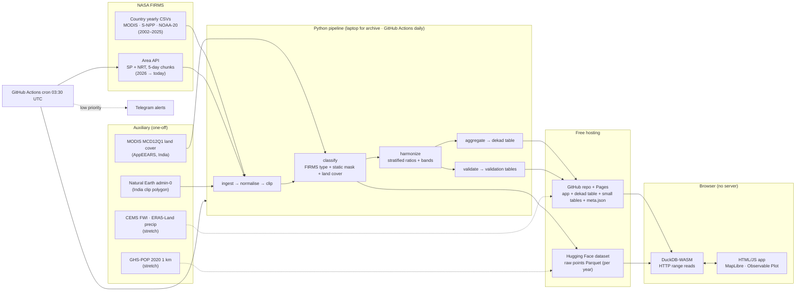
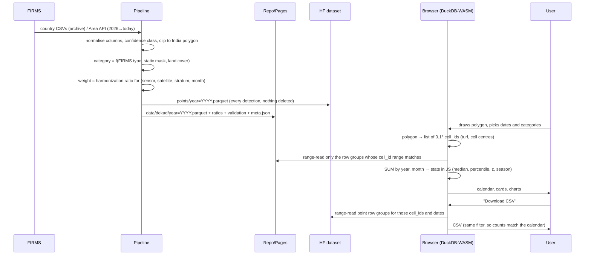

# Harmonized Burning Activity Calendar: Plan

NASA Space Apps Challenge 2026 · Team of 2 · One Claude Code session · 24 h to a deployed app

Status: **draft for review.** No code until this is approved.
ADRs: [`docs/adr/`](adr/). The hour-by-hour build plan is in §13.

---

## 0. Decisions already locked

| Topic | Decision | Source |
|---|---|---|
| Hosting | Static site on GitHub Pages; DuckDB-WASM runs every query in the browser; no server ([ADR-001](adr/001-static-site-duckdb-wasm.md)) | You, this session |
| Monthly table | Grid cell × year-month × category, Parquet, **in the GitHub repo**, same origin as the app, one file per year, each < 100 MB | You |
| Raw points | Parquet on a free Hugging Face dataset; GitHub Releases as fallback; Cloudflare R2 is a later upgrade | You |
| Config | Every data location lives in **one** config value (`config.json`, read by both pipeline and app) | You |
| Hour-1 gate | Verify DuckDB-WASM HTTP range reads from GitHub Pages **and** HF (CORS + partial content) | You |
| Daily job | GitHub Actions: fetch FIRMS NRT → classify (static mask) → republish | You |
| Alerts | Telegram, **low priority** (after the cut line) | You |
| Coverage | **India first**; pipeline is region-agnostic; global after India is done | You |
| Data honesty | No hardcoded, mocked or simulated outputs anywhere. Precomputed files are processed real FIRMS data. If a source is down, show the last successful update time. | You |

### What changed since the brief: facts checked on 13–14 Nov 2026

These facts change the design, so they come first.

1. **Suomi NPP has stopped.** FIRMS stopped producing new S-NPP VIIRS data on **1–2 Nov 2026** ([NASA](https://www.earthdata.nasa.gov/news/blog/transitioning-from-suomi-npp-viirs-omps-what-firms-users-need-know), [NOAA](https://www.nesdis.noaa.gov/news/cessation-of-suomi-national-polar-orbiting-partnership-s-npp-data-users-onafter-november-01-2026)). Its history (Jan 2012 – Oct 2026) stays available. **The harmonized unit therefore becomes NOAA-20 VIIRS-equivalent** (see §4.2), so live data needs no conversion.
2. **MODIS is ending too.** NASA plans end of science for Terra in Feb 2027 and Aqua in Sep 2027 ([Earthdata](https://www.earthdata.nasa.gov/data/alerts-outages/transition-from-modis-viirs)). Terra's orbit has drifted since 2022 and Aqua left the A-Train in 2022. MODIS is only used for 2002–2011, before either drift.
3. **Per-country yearly CSVs still exist** at `https://firms.modaps.eosdis.nasa.gov/data/country/{modis|viirs-snpp|viirs-jpss1}/{YEAR}/{sensor}_{YEAR}_India.csv`, verified with HTTP 200:
   - Coverage runs **through 2025**. 2026 returns 404, and so does NOAA-21 (`viirs-jpss2`).
   - India sizes: MODIS about 1.5–7 MB/year, S-NPP about 45–50 MB/year, NOAA-20 about 27–47 MB/year. **About 1 GB in total**, a download of minutes.
   - Global files are about 80 MB/year zipped for MODIS and about 380 MB/year for *each* VIIRS satellite, more than 15 GB in total. That supports India first.
   - The CSV columns include `type` (0 vegetation, 1 volcano, 2 static land, 3 offshore), `confidence`, `frp`, `daynight` and `satellite`.
4. **FIRMS Area API:** `/api/area/csv/{MAP_KEY}/{SOURCE}/{w,s,e,n}/{DAY_RANGE 1..5}/{YYYY-MM-DD}`.
   - Sources: `MODIS_NRT|MODIS_SP|VIIRS_SNPP_NRT|VIIRS_SNPP_SP|VIIRS_NOAA20_NRT|VIIRS_NOAA20_SP|VIIRS_NOAA21_NRT|VIIRS_NOAA21_SP|LANDSAT_NRT`.
   - Limit: 5,000 transactions per 10 min per key. Large requests may count as several.
   - `/api/data_availability/csv/{MAP_KEY}/ALL` gives the date ranges per source.
   - **Jan 2026 → today must come from this API** (about 65 calls per source for India). That is well within the limit.
5. **Free Hugging Face Docker/Gradio Spaces now require PRO for new accounts** ([community thread](https://discuss.huggingface.co/t/official-community-complaint-revert-free-cpu-basic-spaces-and-remove-anti-developer-sdk-restrictions/177703); not officially announced). HF *datasets* are unaffected, and that's all we use HF for.
6. **Local tools:**
   - Python is only available through the `py` launcher (3.14.3). The `python` command is a Microsoft Store alias.
   - Node 25.2, git 2.51 and gh 2.101 are installed.
   - Hour 0 checks whether Python 3.14 has wheels for `rasterio`. The fallback is `py install 3.12`.
7. **Climate source:** GFWED's NASA portal folder (`v2.0`) was last modified in 2022, so currency is unclear. Climate context (a stretch feature) uses **Copernicus CEMS FWI + ERA5-Land precipitation** instead. Both need one free ECMWF account plus licence acceptance.

---

## 1. Goals, users, success criteria

### 1.1 Why

Fire managers can't compare the 2000s (MODIS) with today (VIIRS) without a fake jump around 2012. The app removes that jump and turns 23+ years of hotspots into a **calendar that answers three questions for any area in seconds**:
- When does this place burn?
- Which years were bad?
- Is this month unusual?

### 1.2 Users and their one question

| User | What they open the app for |
|---|---|
| Early-warning / emergency responder | "Is the current month above normal here, and by how much?" |
| Land manager / forest officer | "When does our fire season start and end, and is it shifting?" |
| Scientist | "Is the series consistent across sensors? Can I download it with uncertainty?" |
| Firefighter / field crew | "Where were the fires in this period?" (map + CSV) |
| Judges (demo) | Punjab stubble season, an Uttarakhand forest-fire year, and the Jharia coal fires showing why classification matters |

### 1.3 Goals, non-goals, anti-goals

- **Goals:**
  - A harmonized, uncertainty-banded hotspot series from mid-2002 to today for any area in India.
  - A calendar with anomalies.
  - Honest exports.
  - A methodology page computed from the data itself.
- **Non-goals (for the 24 h):**
  - Global coverage
  - Forecasts
  - User accounts
  - Burned-area products
  - A mobile-first field app
  - Multilingual UI
  - All of these are in §14.
- **Anti-goals (failure even if the app "works"):**
  - Any number not computed from FIRMS.
  - A visible 2012 step in the harmonized series.
  - Non-vegetation fires silently deleted.
  - Special-case code for the demo areas.
  - A blank page or fake data when a source is down.
  - A colour-only encoding.

### 1.4 Requirement → feature traceability

| # | Requirement (prompt §2) | Satisfied by | Tier |
|---|---|---|---|
| R1 | Harmonized MODIS + VIIRS series, early 2000s → present | F1 harmonized series + bands; Methodology page (§4) | MVP (series) / Core (bands UI, validation page) |
| R2 | Area by drawing on a map or by lat/long, plus date range | Map rectangle/polygon draw; lat/lon + radius and bbox form; date range picker | MVP |
| R3 | Year × month calendar with colour ramp | F2 calendar (count view) | MVP |
| R4 | Top months/years, current month vs median, anomalies vs multi-year averages | F2 "this month vs typical" card (MVP), ranking, anomaly view, z-score/percentile, anomaly bars (Core) | MVP + Core |
| R5 | Number of fires detected | KPI row: hotspots (harmonized + raw by sensor), fire-days, % above typical | MVP |
| R6 | Accessible colour ramps | Documented single-hue sequential + blue↔red diverging with grey midpoint (§8.3); table view for every chart | MVP |
| R7 | CSV of hotspots, downloadable analytics and chart images | Points CSV (MVP); aggregated tables CSV, chart SVG/PNG (Core) | MVP + Core |
| R8 | FIRMS MODIS C6.1 + VIIRS 375 m, archive + NRT | Pipeline (country CSVs + Area API) and daily job | MVP (archive) / Core (daily NRT) |
| — | Classify, don't delete (§3) | F4 categories, toggles, static mask | MVP (tags + default filter) / Core (toggles, per-category calendars) |
| — | Critical periods | F3 season onset/peak/end, early/late flags | Core |

### 1.5 Success criteria (demo-day checklist)

1. For any drawn area in India, the calendar, KPI cards and the CSV come back in **≤ 2 s** for a district-sized area once the engine is warm, and **≤ 6 s** for all of India. Person 2 measures this.
2. Across India, the harmonized annual series shows **no step at 2011→2012**: the ratio of the 2012–14 mean to the 2009–11 mean is within the interannual spread. The raw sum shows a large step. Both appear on the Methodology page.
3. Leave-one-year-out validation reports a median absolute error and band coverage, computed by the pipeline and shown in the app. Target: coverage 70–90 %.
4. The point count in the CSV equals the raw count in the calendar for the same area, period and filters. Tested automatically.
5. A "data as of" badge shows the last successful update per source. When the daily job fails, the badge goes amber after 36 h and the app still works on the last data.
6. A keyboard-only run-through works: area entry by lat/lon, the calendar, and toggles. All charts have a table view.

---

## 2. Architecture

### 2.1 Components



### 2.2 Data flow: FIRMS to a calendar cell on screen



### 2.3 Key architectural choices (details in ADRs)

| Choice | Decision | ADR |
|---|---|---|
| Runtime | Static site, DuckDB-WASM in the browser, no server, no build step (ES modules from jsDelivr) | [001](adr/001-static-site-duckdb-wasm.md) |
| Storage | Parquet. The dekad table goes in the repo; raw points on HF; one `config.json` | [002](adr/002-storage-parquet-split.md) |
| Spatial unit | Regular 0.1° lat/lon grid (not H3); 0.01° sub-grid for the static mask | [003](adr/003-grid-0p1-degree.md) |
| Harmonization | NOAA-20-equivalent units; Aqua-only MODIS; stratified ratio with year-bootstrap bands | [004](adr/004-harmonization-method.md) |
| Map | MapLibre GL JS + mapbox-gl-draw + OpenFreeMap vector tiles (no key) | [005](adr/005-map-maplibre.md) |
| Charts | Observable Plot (SVG; easy SVG/PNG export) | [006](adr/006-charts-observable-plot.md) |
| Hosting and jobs | GitHub Pages + GitHub Actions cron | [007](adr/007-hosting-github-pages-actions.md) |
| Pipeline | Python + DuckDB + pyarrow + rasterio; scripts, not notebooks | [008](adr/008-pipeline-python-duckdb.md) |
| Coverage | India first; any bbox/polygon works with the same code | [009](adr/009-coverage-india-first.md) |
| Alerts | Telegram bot, deep-link subscriptions, evaluated in the daily Action | [010](adr/010-alerts-telegram.md) |

### 2.4 Repository layout (proposed)

```
/config.json                 ← the single data-location config (see §6.4)
/pipeline/                   Python: ingest.py classify.py harmonize.py aggregate.py validate.py daily.py
/pipeline/tests/             pytest
/web/                        index.html, app.js, queries.js, stats.js, calendar.js, map.js, styles.css
/web/tests/                  node --test (stats.js, cells.js)
/data/dekad/year=YYYY.parquet  ← committed, same origin as the app
/data/cells.parquet, ratios.parquet, static_mask.parquet, validation/*.parquet, meta.json
/.github/workflows/daily.yml, pages.yml
/docs/PLAN.md, /docs/adr/
```

The Pages workflow publishes `/web` and `/data` together, so both are served from one origin.

---

## 3. Data sources

| Product | Resolution | Period used | Access | Fields used |
|---|---|---|---|---|
| FIRMS MODIS C6.1 (Aqua + Terra), standard processing | 1 km at nadir | 2002-07 → 2025 (Aqua in the harmonized series; Terra stored and exported only) | Country CSV `modis/{Y}/modis_{Y}_India.csv` | latitude, longitude, acq_date, acq_time, satellite, confidence (0–100), frp, daynight, type, brightness, version |
| FIRMS VIIRS 375 m S-NPP (VNP14IMG), SP | 375 m | 2012-01-20 → 2026-11-01 (ended) | Country CSV `viirs-snpp/...` (≤2025); Area API `VIIRS_SNPP_SP` for 2026 (one-off backfill) | as above + confidence (l/n/h), bright_ti4/ti5 |
| FIRMS VIIRS 375 m NOAA-20 (VJ114IMG), SP + NRT | 375 m | 2018 → today (**harmonized baseline**) | Country CSV `viirs-jpss1/...` (≤2025); Area API `VIIRS_NOAA20_SP` / `_NRT` (2026 →) | as above |
| FIRMS VIIRS 375 m NOAA-21, SP + NRT | 375 m | 2024 → today | Area API only (`VIIRS_NOAA21_*`) | Stored and exported; not in the series (§4.4); backup baseline if NOAA-20 fails |
| FIRMS MODIS NRT | 1 km | 2026 → MODIS end | Area API `MODIS_NRT` / `MODIS_SP` | Stored and exported only |
| MODIS land cover MCD12Q1 v061, LC_Type1 (IGBP) | 500 m, annual | One recent year (2023 or latest) | NASA AppEEARS area request (Earthdata login) → GeoTIFF; fallback MCD12C1 0.05° via `earthaccess` | IGBP class → category (§5) |
| Natural Earth admin-0, 1:10m | vector | — | naturalearthdata.com (public domain) | India polygon used to clip NRT and archive alike (§5.4) |
| Copernicus CEMS historical FWI (ERA5-based) *(stretch)* | 0.25°, daily | 2002 → present | ECMWF EWDS API (account + licence) | Monthly mean FWI per 0.1° cell (nearest) |
| ERA5-Land monthly precipitation *(stretch)* | 0.1°, monthly | 2002 → present | Copernicus CDS API (same account) | Monthly precip and anomaly vs 2003–2025 |
| GHS-POP R2023A 2020 *(stretch)* | 30″ (~1 km) | 2020 | JRC download (no login) | Population per 0.01° cell |

---

## 4. Harmonization methodology (scientific core)

### 4.1 Problem in one paragraph

VIIRS detects many more hotspots than MODIS for the same fires. Its 375 m pixels resolve several detections per MODIS footprint, and it is more sensitive, so it catches small and night fires. Adding the two, or switching sensors in 2012, creates a fake jump. On top of that, three VIIRS satellites came online one by one (2012, 2018, 2023), and two MODIS satellites drift late in life. The fix has three parts:
- pick one baseline per sensor family
- convert everything to one unit using the overlap years
- carry the conversion error forward as bands

### 4.2 Output unit and the chain of baselines

**Unit: "NOAA-20-equivalent hotspots"** (and NOAA-20-equivalent fire-days).

| Period | Observed by | Conversion | Band |
|---|---|---|---|
| 2018-01 → today | **NOAA-20 VIIRS** (baseline) | none (weight 1) | none |
| 2012-01-20 → 2017-12 | S-NPP VIIRS | × `s[stratum, month]` (S-NPP→NOAA-20, fitted 2018–2025) | from `s` |
| 2002-07 → 2011-12 | **Aqua** MODIS | × `r[stratum, month]` (Aqua→S-NPP, fitted 2012–2021) × `s` | from `r` and `s` combined |

Why NOAA-20 and not S-NPP:
- S-NPP ended on 1 Nov 2026, so live data and the "current month" (the most-used numbers) come from NOAA-20.
- Using NOAA-20 as the unit means **the current month needs no conversion**.
- S-NPP and NOAA-20 carry the same instrument half an orbit apart (both around 13:30 / 01:30). `s` is close to 1 with a small error, fitted on about 8 overlap years.

Why Aqua only:
- Aqua's overpasses (about 13:30 / 01:30) match VIIRS. Terra's (about 10:30 / 22:30) see a different part of the daily fire cycle.
- Terra's crossing time has drifted earlier since 2022.
- Aqua is stable through 2021 and only drifted after leaving the A-Train in 2022. That's why the Aqua→S-NPP fit uses **2012–2021 only**.
- Cost: the series starts **July 2002** (first full year 2003), not 2000. Climatologies and percentiles use **2003–2025** as the base period.
- Terra-based 2000–2002 is a stretch extension (§14).

Within VIIRS, we **pick one baseline satellite rather than deduplicate**. Merging S-NPP + NOAA-20 + NOAA-21 detections would raise counts each time a satellite was added, because two passes 50 min apart catch more short fires. Other satellites' detections are still stored, shown in the raw panels and exported, with `harm_weight = 0`.

**Baseline gaps** (e.g. the NOAA-20 outages): a dekad in which the baseline has zero detections across the whole processed region, while another VIIRS satellite has detections, is flagged `baseline_gap`. Its harmonized value is then taken from the other satellite × its ratio, and the tooltip marks it "filled from S-NPP/NOAA-21". This is Core tier. In the MVP, gap dekads are only flagged.

### 4.3 Spatial unit

Calibration and storage use a **0.1° grid cell** (about 11 km; [ADR-003](adr/003-grid-0p1-degree.md)). Counting per cell, not per point pair, means VIIRS's 3–6 detections per MODIS footprint are compared at the same footprint-free scale. The ratio absorbs the pixel-count difference *on average*, and fire-days per cell is the resolution-robust alternative (§4.7).

### 4.4 Filters applied before fitting and counting

| Filter | Rule | Why |
|---|---|---|
| Confidence | MODIS `confidence ≥ 30` (nominal + high); VIIRS `confidence ∈ {n, h}` | Matches FIRMS's own low/nominal/high split on both sensors; removes most sun-glint and edge-of-scan false alarms |
| Category | Fit on **landscape categories only** (agricultural, forest, grass/shrub, other-vegetation). Static/industrial gets its **own** stratum. Volcanic and offshore are not harmonized. | Persistent sources behave nothing like landscape fires and would skew the ratio |
| Day/night | Both day and night included in both sensors | Both sensor families overpass at about 13:30 and 01:30, so the ratio absorbs the night-sensitivity difference. Methodology shows a day-only fit as a sensitivity check. |
| FRP threshold | **None** | A VIIRS FRP cut would throw away the small fires the brief cares about (crop residue). The ratio already maps MODIS to VIIRS sensitivity. Revisit if the hold-out error is large for small-fire strata. |
| Low-confidence points | Kept in the raw files, `conf_class = 'l'`, counted in `n_lowconf`; excluded from counts by default | Classify, don't delete |

### 4.5 Conversion: stratified ratio of totals

- **Stratum = category × calendar month.** Categories: agricultural, forest, grass/shrub/savanna, other vegetation, urban, static/industrial. That's 6 × 12 = 72 ratios per link. Volcanic and offshore are not harmonized. When the global extension comes, a region dimension is added (IPCC/WWF biome).
- For each link (Aqua→S-NPP, S-NPP→NOAA-20) and stratum, over the fit years:
  ```
  r[stratum, month] = Σ_years Σ_cells V(cell, y, month) / Σ_years Σ_cells M(cell, y, month)
  ```
  The ratio of *totals*, not a mean of per-cell ratios. It is fitted on cells that are in that stratum, using all cells, including cells with M = 0 and V > 0.
- **Why a ratio of totals.**
  - Users look at *sums over areas*. A ratio of totals is unbiased for sums, and it carries the "VIIRS sees small fires MODIS misses entirely" effect, which a per-cell regression on M > 0 cells would miss.
  - Per-cell log-linear regression and quantile mapping were considered and rejected for the 24 h build. Both need zero-inflation handling, and quantile mapping can't produce VIIRS fires in cells where MODIS saw zero. That is noted in ADR-004 and could be tested later.
- **Shrinkage for thin strata.** If a stratum-month has fewer than 200 baseline detections summed over the fit years, the pipeline falls back to that class's all-months ratio, and then to the all-landscape ratio. The fallback used is stored in `ratios.parquet` and shown in the tooltip.
- **Applied per point:** each point's `harm_weight` is the product of the ratios on its chain. A cell-dekad's harmonized count is Σ weights, so the CSV, the dekad table and the calendar all agree.

### 4.6 Uncertainty bands

- **Year-bootstrap band.** For each link and stratum-month, compute the ratio for each fit year separately, e.g. 10 yearly ratios for Aqua→S-NPP. `r_lo` and `r_hi` are the 10th and 90th percentiles of those yearly ratios, so the band reflects *interannual* instability of the conversion, which is the real error source.
- **Chained link:** `lo = r_lo · s_lo`, `hi = r_hi · s_hi`. This is conservative: it assumes the links are perfectly correlated.
- **For area sums:** `harm_lo = Σ count × lo`, `harm_hi = Σ count × hi`. Also conservative, since the strata are treated as perfectly correlated. It's labelled "≈80 % range (conservative)".
- The band is shown as a shaded ribbon on the annual and monthly line charts, and as "± range" in calendar tooltips for pre-2018 cells. Observed NOAA-20 values have no band.
- Hold-out band coverage (§4.8b) checks whether "≈80 %" is honest. If coverage is far off, the label shows the measured coverage instead.

### 4.7 Metrics offered

| Metric | Definition | Use when |
|---|---|---|
| **Harmonized hotspots** (default) | Σ harm_weight of baseline-chain detections | Comparing *amount* of burning across years; matches what FIRMS users expect |
| **Fire-days** | Σ over cells of days with ≥1 baseline-chain detection, converted with its own ratio set `r_fd`, `s_fd` (same method) | Comparing *extent × persistence*. Robust to pixel size, because a cell burning on a day counts once whether VIIRS saw 1 or 12 pixels. Better for small areas and for crossing the MODIS→VIIRS gap. Fewer counts, lower variance. |
| Raw counts per sensor/satellite | Unconverted counts per instrument | Transparency; Methodology and export |

The UI explains each in one sentence next to the toggle.

### 4.8 Validation (computed by `validate.py`, rendered on the Methodology page)

- **(a) Step removal, before vs after.**
  - India-wide annual and monthly series: raw MODIS (Aqua), raw S-NPP, raw NOAA-20, naive sum (all sensors), harmonized ± band.
  - Statistic: the step ratio `mean(2012–14) / mean(2009–11)` for naive vs harmonized, alongside the typical year-to-year ratio spread, which shows what "no step" looks like.
  - Repeated for each walkthrough area. These are drawn live by the same query layer and not stored as special cases. The pipeline also writes the same statistic for every 1°×1° box with enough fire.
- **(b) Hold-out within the overlap: leave-one-year-out (LOYO).**
  - For each year Y in 2012–2021, fit `r` on the other 9 years, predict S-NPP from Aqua for year Y, then compare with observed S-NPP.
  - Report median absolute % error and bias for stratum-month totals, for 1°×1° boxes (months with ≥ 50 observed hotspots), and for India-wide months.
  - Also report **band coverage**: the % of held-out units whose observed value falls inside [lo, hi].
  - Same procedure for S-NPP→NOAA-20 over 2018–2025.
  - **Also report the direct Aqua→NOAA-20 fit (2018–2021)**. Methodology states which link did better, and the chain is kept unless the direct fit wins clearly.
- **(c) Breakdown.** Error and coverage by land-cover class and by month, as a small table plus a dot plot. Global regions are added later.
- **Sensitivity checks** (cheap, Core tier): day-only fit; fire-days vs hotspots; with and without static stratum.

### 4.9 Risks specific to harmonization

| Risk | Effect | Mitigation |
|---|---|---|
| Ratios vary by fire size and regime within a stratum | Bias in small or unusual areas | Show bands; LOYO by class; the fire-days metric as a robust alternative; global expansion adds a region dimension |
| Thin strata (e.g. grassland in a wet month) | Unstable `r` | Shrinkage fallback (§4.5), recorded per ratio |
| NOAA-20 gaps or degradation | Dips in the baseline | `baseline_gap` flag; fill from NOAA-21 (Core); NOAA-21→NOAA-20 ratio from the 2024–25 overlap via the API (stretch) |
| VIIRS collection change (C2) or reprocessing | Small level shifts | Store `version`; methodology lists versions used |
| India-only fit applied elsewhere later | Wrong ratios abroad | Pipeline refits per region; ratios carry their region |

---

## 5. Classification: classify, don't delete

### 5.1 Categories

| Category | Rule (first match wins) | Default visible |
|---|---|---|
| `volcanic` | FIRMS `type = 1`, or point in a static-mask cell with reason `volcano` | no |
| `offshore` | FIRMS `type = 3`, or land-cover class water (IGBP 17) / outside land | no |
| `industrial` | FIRMS `type = 2`, or point in a static-mask cell (§5.3) | no |
| `urban` | `type = 0` and IGBP 13 (urban/built-up) | no |
| `agricultural` | `type = 0` and IGBP 12 (croplands) or 14 (cropland/natural mosaic) | **yes** |
| `forest` | `type = 0` and IGBP 1–5 (forests) | **yes** |
| `grass_shrub` | `type = 0` and IGBP 6–10 (shrublands, savannas, grasslands) | **yes** |
| `other_veg` | `type = 0` and any other class (wetlands 11, barren 16, snow 15) | **yes** |

- "Landscape fires" = agricultural + forest + grass_shrub + other_veg. That's the default view and the harmonization fit set.
- Brick kilns, a large persistent source in north India, fall into `industrial` through the persistence rule even when FIRMS gives them `type = 0`.
- Land cover is one recent year (shortcut: cropland/forest change over 23 years is ignored; upgrade to per-year MCD12Q1 later, §14).

### 5.2 Why the FIRMS `type` alone isn't enough

NRT data has no `type`, and the archive's `type` is only assigned in standard processing. If we used `type` in the archive and nothing in NRT, a gas flare would jump from `industrial` to `agricultural` when its month moved from SP to NRT. Rule: **the same mask is applied to archive and NRT points**, and FIRMS `type` is *added* to it, never the only input.

### 5.3 Static-source mask (the algorithm)

- **Grid:** 0.01° (about 1.1 km), so a flare or kiln doesn't mask a whole 11 km cell.
- **Inputs:** the last **5 complete years** of baseline-family VIIRS detections (NOAA-20 + S-NPP, n/h confidence), plus all archive points with FIRMS `type ∈ {1, 2}`.
- **A 0.01° cell joins the mask when either holds:**
  1. **FIRMS says so:** ≥ 3 detections with `type = 2` (reason `firms_static`) or `type = 1` (reason `volcano`) in the 5 years.
  2. **Persistence:** fire detected on **≥ 30 distinct days in ≥ 3 of the 5 years**, and the cell's detections are spread over **≥ 6 calendar months** in at least one year (reason `persistent`). The month spread keeps an intense crop-residue cell, which burns many days in two short windows, out of the mask.
- **Output:** `data/static_mask.parquet` (`cell001_id, reason, n_days_by_year`). It's small: thousands of rows for India.
- **Refresh:** rebuilt whenever a new standard-processing year is ingested, about yearly, by the same `classify.py --rebuild-mask`. The daily job only *reads* it. Thresholds live in the pipeline, and the mask build reports how many cells and points each rule captured. Methodology shows the counts and a map of mask cells.
- **Check:** Jharia coalfield, Mumbai High and the Jamnagar refineries should appear. Person 2 verifies this visually. The threshold isn't tuned to them, and if they don't appear, that's reported, not patched.

### 5.4 Clipping

The archive country CSVs are clipped by FIRMS's country boundary, while NRT is fetched by bbox. To keep them consistent, **both** are clipped to the same Natural Earth India polygon (plus a 0.1° buffer so coastal flares stay in).
- Political boundary note: the Survey of India boundary differs from Natural Earth in disputed areas. The app's map uses a basemap without disputed-boundary lines where possible and states the source. This is listed in risks.

### 5.5 What the user sees

- Category toggles in the left rail. Defaults: the four landscape categories on, the rest off.
- **"Per-category calendars"**: small multiples, one calendar per visible category, each with its own count scale. This is what shows Jharia's flat, year-round industrial band next to Punjab's two crop seasons.
- Map points are coloured by **category group** (3 colours, §8.3): landscape, industrial/static, other non-landscape (urban, volcanic, offshore). The exact category appears in the tooltip and the CSV.

---

## 6. Data model

### 6.1 Raw points: `points/year=YYYY.parquet` on the HF dataset

- One file per year, all sensors, **every detection kept**.
- Sorted by `cell_id, acq_date`, so DuckDB row-group min/max statistics let an area query skip most of the file.
- Row groups of about 100k rows, zstd compression.

| Column | Type | Notes |
|---|---|---|
| `lat`, `lon` | DOUBLE | as published |
| `acq_date` | DATE | UTC |
| `acq_time` | SMALLINT | HHMM UTC |
| `sensor` | VARCHAR | `MODIS` / `VIIRS` |
| `satellite` | VARCHAR | normalised: `Aqua`, `Terra`, `SNPP`, `NOAA20`, `NOAA21` |
| `confidence_raw` | VARCHAR | as published (`0–100` or `l/n/h`) |
| `conf_class` | VARCHAR | `l` / `n` / `h` (MODIS: <30 l, 30–79 n, ≥80 h) |
| `frp` | REAL | MW |
| `daynight` | VARCHAR | `D` / `N` |
| `brightness` | REAL | MODIS `brightness` / VIIRS `bright_ti4` |
| `firms_type` | TINYINT NULL | null for NRT |
| `category` | VARCHAR | §5.1 |
| `cell_id` | INTEGER | 0.1° cell (§6.3) |
| `cell001_id` | BIGINT | 0.01° cell |
| `in_baseline_chain` | BOOLEAN | Aqua ≤2011, S-NPP 2012–2017, NOAA-20 ≥2018, after filters |
| `harm_weight` | REAL | 0 if not in chain; else product of ratios |
| `harm_weight_lo`, `harm_weight_hi` | REAL | band |
| `processing` | VARCHAR | `SP` / `NRT` |
| `version` | VARCHAR | FIRMS collection version |

Estimated size for India: about 250–350 MB in total, about 10–25 MB per VIIRS-era year.

### 6.2 Aggregated table: `data/dekad/year=YYYY.parquet` in the repo

This is your "monthly table", with **one added dimension: dekad** (days 1–10, 11–20, 21–end).
- **My call, for two reasons.** "Current month vs typical" needs a fair month-to-date comparison: on 14 Nov you compare 1–10 Nov plus part of the next dekad, not a full November. Season onset/end also gets about 10-day resolution instead of about 30.
- A month is the sum of its 3 rows.
- Size estimate for India: about 3–5 MB per year, about 100 MB in total, far under 100 MB per file.

| Column | Type | Notes |
|---|---|---|
| `cell_id` | INTEGER | sort key |
| `year`, `month`, `dekad` | SMALLINT, TINYINT, TINYINT | |
| `category` | TINYINT | enum code (§5.1) |
| `n_aqua`, `n_terra`, `n_snpp`, `n_noaa20`, `n_noaa21` | INTEGER | raw counts after confidence filter |
| `n_lowconf` | INTEGER | excluded low-confidence count (all sensors) |
| `harm_n`, `harm_n_lo`, `harm_n_hi` | REAL | harmonized hotspots + band |
| `fd_base` | SMALLINT | days with ≥1 baseline-chain detection |
| `harm_fd`, `harm_fd_lo`, `harm_fd_hi` | REAL | harmonized fire-days + band |
| `frp_sum`, `frp_max` | REAL | baseline-chain FRP |
| `harm_from` | TINYINT | `0` NOAA-20 observed, `1` S-NPP converted, `2` Aqua converted, `3` gap-filled |
| `processing` | TINYINT | `0` SP, `1` NRT (lets the UI mark provisional months) |

### 6.3 Grid definitions

```
cell_id    = floor((lat + 90) * 10) * 3600 + floor((lon + 180) * 10)          -- 0.1°
cell001_id = floor((lat + 90) * 100) * 36000 + floor((lon + 180) * 100)       -- 0.01°
```
- Edge rule: `lat = 90` and `lon = 180` clamp into the last row/column.
- Cell centre = index + 0.05°.
- Because `cell_id` is row-major, cells in the same latitude band are contiguous, so a compact area hits few row groups.

### 6.4 Small tables and the single config

| File | Contents |
|---|---|
| `data/cells.parquet` | `cell_id, lat_c, lon_c, lc_class, in_coverage` |
| `data/ratios.parquet` | `link, stratum, month, r, r_lo, r_hi, n_years, n_detections, fallback` |
| `data/static_mask.parquet` | §5.3 |
| `data/validation/*.parquet` | step stats, LOYO results, breakdown |
| `data/meta.json` | per-source `last_success_utc`, `coverage_start/end`, `last_sp_date`, pipeline git SHA, run status |

`config.json`, the one place data locations live, is read by `pipeline/*.py` and fetched by `web/app.js` at startup:
```json
{ "data": {
    "dekad":  "./data/dekad/",
    "tables": "./data/",
    "points": "https://huggingface.co/datasets/<org>/<repo>/resolve/main/points/"
} }
```
Switching to GitHub Releases or R2 means editing one line.

---

## 7. "API" specification

There is no server, so the API is a **query module in the browser** (`web/queries.js`) plus the **static file contract** (§6). Each function takes an `Area` (list of `cell_id`s plus the drawn geometry for display), a date range and filters. It returns plain arrays, and stats are computed in `web/stats.js` (pure JS, unit-tested). Every query reads only real files. If a read fails, the function throws a typed error and the UI shows "Couldn't load <file>: <reason>". It never shows fallback numbers.

| Function (≈ endpoint) | Inputs | Output | Reads |
|---|---|---|---|
| `areaCells(geometry)` | polygon / bbox / point + radius km | `cell_id[]`, snapped outline GeoJSON | `cells.parquet` (in-coverage check) |
| `calendar(area, {from,to}, cats, metric)` | | rows `{year, month, value, lo, hi, harm_from, provisional}` | dekad files for years in range |
| `climatology(area, cats, metric, base=[2003,2025])` | | per month: median, mean, sd, p10/p90 and the sorted yearly values (for percentiles) | dekad files |
| `monthToDate(area, cats, metric, today)` | | current month's complete dekads + the same dekads in each base year → median, percentile, z | dekad files |
| `annual(area, cats, metric)` | | per year `{value, lo, hi}` + raw per sensor | dekad files |
| `season(area, cats, metric)` | | climatological onset/peak/end (dekad → date) + per-year onset/end, flags | dekad files (§9 F3) |
| `categoryCalendars(area, from, to)` | | `calendar` grouped by category | dekad files |
| `points(area, from, to, cats, opts)` | `limit` for map display | point rows (all §6.1 columns) | HF points files |
| `pointsCSV(...)` | same | streamed CSV Blob | HF points files |
| `aggregatesCSV(area, ...)` | | monthly table CSV with value, band, percentile, z | dekad files |
| `timelapseFrames(area, from, to, step='day'|'week')` *(stretch)* | | `{t, points[]}` frames | HF points files |
| `compare(areaA, areaB | yearA, yearB)` *(stretch)* | | two `calendar` + `annual` results | dekad files |
| `climate(area, from, to)` *(stretch)* | | monthly FWI mean, precip anomaly | `climate/…parquet` |
| `exposure(area, from, to, cats)` *(stretch)* | | population in 1-km cells with or next to a hotspot | HF `pop001.parquet` + points |
| `meta()` | | `meta.json` → freshness badge | `meta.json` |

Alert subscriptions are not part of the browser API: they are Telegram deep links (§9 F9).

**Statistics definitions (stats.js):**
- `median`: on base-period years.
- `percentileRank(x, base)` = (count(base < x) + 0.5·count(base = x)) / n × 100.
- `z = (x − mean) / sd`, with sample sd. It shows "—" when sd = 0 or n < 5.
- `anomaly% = (x − median) / median`. It shows "—" when median = 0 and says "no typical activity".

---

## 8. Frontend: screens and interactions

### 8.1 Design direction (frontend-design pass)

- **Subject:** a fire-operations instrument for Indian forest and disaster-management officers, readable on a projector in a control room.
- **One bold element: the calendar.** A large year × month grid, with the current month outlined. A pinned **"typical year" row** (the climatological median) sits at the bottom, so every year is read against normal. Everything else stays quiet.
- **Tokens:**

| Token | Light | Dark | Role |
|---|---|---|---|
| `--surface-1` | `#fcfcfb` | `#1a1a19` | chart/page surface (from the dataviz reference palette) |
| `--panel` | `#eef1f4` | `#24272b` | left rail, cards (cool grey: an instrument, not paper) |
| `--ink` | `#1d2433` | `#eceef2` | text (deep slate, not tinted black) |
| `--ink-2` | `#4a5263` | `#b9bfca` | secondary text |
| `--action` | `#184f95` | `#86b6ef` | buttons, links, focus ring (blue 600/250; ≥ 4.5:1 on surface) |
| status good/warning/serious/critical | `#0ca30c` `#fab219` `#ec835a` `#d03b3b` | same | freshness badge only, always with icon + text |

- **Type:** **Public Sans** (the US Web Design System face; plain, official, highly legible), one family. Tabular figures in tables and axes. The scale is 14 / 16 / 20 / 28 px.
- **Alignment:** left-aligned throughout; numbers right-aligned in tables.
- **Review against the brief.**
  - The first idea was a dark "mission control" theme with a fire-orange accent. That's the generic near-black-with-one-bright-accent look, and it also makes orange carry meaning in the UI that should belong to data.
  - Changed to a light cool-grey instrument with dark mode as an option. Orange and red stay reserved for "above normal" in the anomaly view.
- **Avoided defaults:** no all-caps eyebrow labels, no card grid with identical shadows, no "→" on buttons, no gradient washes.

### 8.2 Layout (desktop ≥ 1200 px)

```
┌───────────────────────────────────────────────────────────────────────────────────────┐
│ Burning Activity Calendar        Area: 2 341 km² · 31 cells      ● Data as of 14 Nov 03:41 UTC  Methodology │
├──────────────────┬────────────────────────────────────────────────────────────────────┤
│ Area             │  MAP (MapLibre)                                                     │
│ [▭ Rectangle]    │  drawn shape + snapped 0.1° cells outline + points (≤ 20 k shown)   │
│ [⬠ Polygon]      │                                                                     │
│ Lat [ ] Lon [ ]  │                                                                     │
│ Radius [25] km   │                                                                     │
│ [Use this area]  ├────────────────────────────────────────────────────────────────────┤
│                  │  KPI row: Hotspots (harm.) · Fire-days · This month vs typical ·    │
│ Dates            │           Busiest month · Busiest year                              │
│ [2003-01]–[now]  ├──────────────────────────────────────────────┬─────────────────────┤
│                  │  CALENDAR (hero)                             │ This month vs typical│
│ Categories       │        J F M A M J J A S O N D               │  Nov 1–10: 4 210     │
│ ☑ Agricultural   │  2026  ▢ ▢ ▢ ▣ ▣ ▢ ▢ ▢ ▢ ▣ ▣ ·               │  typical: 6 900      │
│ ☑ Forest         │  2025  ...                                   │  31st percentile     │
│ ☑ Grass/shrub    │  ...                                         │  z = −0.6            │
│ ☑ Other veg.     │  2003  ...                                   ├─────────────────────┤
│ ☐ Industrial     │  typical ▢ ▢ ▢ ▣ ▣ ▢ ▢ ▢ ▢ ▣ ▣ ▢             │ Top months / years   │
│ ☐ Urban          │  [Counts | Anomaly]  [Hotspots | Fire-days]  │                      │
│ ☐ Volcanic       │  legend + [Show table]                       │                      │
│ ☐ Offshore       ├──────────────────────────────────────────────┴─────────────────────┤
│                  │ Tabs: Trend · Anomalies · Season · Categories · Compare* · Timelapse* · Download │
│ [Download ▾]     │  (tab panels: annual line + band, anomaly bars, season strip, ...)  │
└──────────────────┴────────────────────────────────────────────────────────────────────┘
```

- **Mobile (< 768 px):** single column in the order header → area form → KPI → calendar (horizontal scroll inside its own container, year labels sticky) → map → tabs. Page gutter 16 px; no page-level horizontal scroll.
- **Methodology page:** a separate `methodology.html` with the before/after chart, step statistics, LOYO table, breakdown dot plot, ratio table, mask counts, data sources and versions. All of it is read from `data/validation/*` and `ratios.parquet`.

### 8.3 Colour ramps (dataviz rules, documented palette only)

| Use | Encoding | Ramp | Accessibility notes |
|---|---|---|---|
| Calendar counts | **sequential, one hue** | Blue 100 → 700 (`#cde2fb` … `#0d366b`), 7 quantile bins on the area's own non-zero values. "0" is the surface colour with a hairline border. | Single-hue lightness ramp, so it reads in every colour-vision type and in greyscale. Dark mode uses its own steps against `#1a1a19`. Bins are labelled with numbers in the legend. |
| Calendar anomaly | **diverging** | Blue arm (below typical) ↔ grey midpoint (`#f0efec` / dark `#383835`) ↔ red arm (above typical), 3 steps per arm. Binned on percentile: ≤10, 10–25, 25–40, 40–60 (grey), 60–75, 75–90, ≥90. | Blue↔red is safe for protan/deutan readers because the lightness differs on each arm. Each cell's tooltip and table give the number. |
| Map points by category group | **categorical, all-pairs** (map) | Slot 1 blue `#2a78d6` landscape · slot 2 orange `#eb6834` industrial/static · slot 3 aqua `#1baf7a` other. Dark: `#3987e5`, `#d95926`, `#199e70`. | All-pairs map form, so capped at **3 slots** (the reference palette validates its first three all-pairs in both modes). Aqua is under 3:1 on light, so points have a 1 px surface ring and the legend is always visible. |
| Raw sensor lines (Methodology) | categorical, adjacent | slots 1–4 (Aqua, S-NPP, NOAA-20, naive sum) | ≥ 2 series, so there's a legend plus direct end labels |
| Freshness badge | status | good (< 36 h) / warning (36–72 h) / critical (> 72 h or last run failed) | icon + text always |

- The build **runs `validate_palette.js`** for any categorical set we use (light and dark), as a test task (§11).
- The texture fill is available when `forced-colors` is active.
- No dual-axis charts. Climate context gets its own panel stacked above the hotspot chart, sharing the time axis.

### 8.4 Interactions

- **Area entry:**
  - Rectangle or polygon draw (mapbox-gl-draw), or a lat/lon point with radius, or a bbox (W, S, E, N) typed into fields.
  - Geometry is snapped to 0.1° cells by cell centre and drawn as an outline, so users see exactly what's counted.
  - An area outside coverage gets "No data coverage here yet (India only for now)". An area with zero fires shows an empty calendar with the text "No hotspots detected in this area for the selected period".
- **Date range:** two month inputs, from 2002-07 to the current month. Presets: "Last 12 months", "Full record", "This year".
- **Calendar:**
  - Hover or focus a cell to see month, value, ± band, percentile, z-score, the source (observed NOAA-20 / converted S-NPP / converted Aqua) and "provisional (NRT)" where it applies.
  - Click a month to filter the map to it.
  - Arrow keys move between cells, with a roving tabindex.
- **Category toggles** re-run the queries. Colours follow the category group and never re-rank.
- **Downloads menu:**
  - Hotspots CSV, with a row-count warning above 500 k.
  - Monthly table CSV.
  - Annual table CSV.
  - Each chart as SVG/PNG.
  - Methodology tables.
- **Freshness badge:** reads `meta.json`. The tooltip lists the last success per source.

### 8.5 Accessibility plan (WCAG 2.1 AA)

| Area | Commitment |
|---|---|
| 1.1.1 / 1.3.1 | The calendar is a real `<table>` with `<th scope>`, and each cell has an `aria-label`, e.g. "November 2024, 12 345 hotspots, 97th percentile". Each chart has a "Show table" toggle and a short text summary. |
| 1.4.3 / 1.4.11 | Text ≥ 4.5:1 on all surfaces; UI borders and focus ≥ 3:1; sub-3:1 data colours always have labels or a table (relief rule) |
| 2.1.1 | Drawing is mouse-only, so the **lat/lon and bbox form is the full keyboard alternative**. Calendar arrow-key navigation, tabs (`role=tablist`) and toggles are native checkboxes. |
| 2.4.7 | Visible 2 px `--action` focus ring everywhere |
| 2.5.5 | Controls ≥ 44 × 44 px |
| 2.2.2 | The timelapse never autoplays; pause, scrub and speed controls; respects `prefers-reduced-motion` |
| 3.3.1 / 3.3.2 | Inputs labelled; errors explain the fix, e.g. "Latitude must be between 6 and 38 for India coverage". |
| 4.1.2 | Live region (`aria-live=polite`) announces "Calendar updated: 23 years, 31 cells" after each query |
| Zoom | Layout holds at 200 % zoom (the rail collapses above the map) |

---

## 9. Feature specs

The tier is in brackets. MVP must ship. Core is expected. Stretch only if time remains.

### F1. Harmonized series with uncertainty bands [MVP series · Core bands + Methodology]
- **Purpose:** one consistent series from 2002 to today.
- **User story:** As a scientist, I want one series whose 2012 transition has no artificial jump, with its uncertainty, so that I can compare decades.
- **Inputs:** points → `harm_weight` (§4) → dekad table.
- **Compute:** pipeline (§4.5–4.6); area sums in the browser.
- **UI:** annual line with shaded band (Trend tab); monthly line with band; pre-2018 values marked "converted".
- **Accept:**
  - (1) Raw counts and harmonized counts reconcile with the points file for 3 random areas (test).
  - (2) The India step statistic for harmonized is inside the year-to-year spread, and the naive sum is outside it.
  - (3) Bands are visible only on converted periods.
  - (4) The Methodology page renders validation from files.

### F2. Burning calendar + anomalies [MVP counts + this-month card · Core anomaly view, rankings, trend, anomaly bars]
- **Purpose:** see the area's fire history and how now compares.
- **User story:** As a responder, I want to see whether this month is above the area's normal, so that I can raise readiness.
- **Inputs:** dekad table; `climatology`, `monthToDate`.
- **Compute:** sums by year-month; base period 2003–2025 (excluding the current year); percentile rank, z-score and anomaly % (§7).
- **UI:** calendar (§8), Counts/Anomaly toggle, "typical" row, "This month vs typical" card (month-to-date by dekad), top-5 months and years list, anomaly bar chart (annual, diverging colours around 0).
- **Accept:**
  - (1) Calendar totals equal `annual` totals.
  - (2) Month-to-date uses only completed dekads, and the card says which days are compared.
  - (3) A z-score with sd = 0 shows "—".
  - (4) Every cell is reachable by keyboard with a correct label.
  - (5) Colours come only from the ramps in §8.3.

### F3. Fire-season detection [Core]
- **Purpose:** critical periods: when the season starts, peaks and ends, and whether a year was early or late.
- **User story:** As a land manager, I want the typical season window and this year's deviation, so that I can time patrols and controlled burns.
- **Compute:**
  - Climatological dekad series (36 values), median per dekad over 2003–2025.
  - **Circular year:** start the cumulative sum at the dekad after the climatological minimum, so seasons crossing 31 Dec work.
  - Onset = dekad where cumulative share first reaches 10 %; peak = max dekad; end = 90 %. Per year, the same on that year's dekads (with the same circular start).
  - Flag early or late when onset or end is outside the base-period interquartile range. Flag longer or shorter likewise for length.
  - **Bimodal note:** if two separated dekad clusters each exceed 25 % of the annual total, report "two seasons" with each cluster's peak. Punjab has wheat in Apr–May and paddy in Oct–Nov.
  - Activity below 30 detections per year on average gets "Not enough fires to define a season".
- **UI:** Season tab with a horizontal strip (36 dekads) showing the climatological band, plus one row per year with an onset–end bar, early/late badges (icon + text) and a sentence summary.
- **Accept:**
  - (1) Unit tests cover a single season, a season crossing the year boundary, a bimodal series and an empty series.
  - (2) Resolution is stated as "±10 days".

### F4. Fire type classification [MVP tags + default filter · Core toggles + per-category calendars + mask on map]
- **Purpose:** see what is burning without deleting anything.
- **User story:** As a scientist, I want industrial and volcanic hotspots separated but available, so that persistent flares don't inflate wildfire statistics.
- **Compute:** §5.
- **UI:** toggles, per-category small-multiple calendars (Categories tab), static-mask cells as an optional map layer.
- **Accept:**
  - (1) The sum over all categories equals the total points (no deletion; test).
  - (2) The mask is applied identically to SP and NRT (test on a mask cell).
  - (3) Category counts appear in the CSV.

### F5. Walkthrough areas [MVP as test cases · demo script]

Not in code. These are areas Person 2 draws live, and used as real test cases throughout:

| Area | Approx. bbox (W, S, E, N) | Shows |
|---|---|---|
| Punjab + Haryana (stubble burning) | 73.8, 29.5, 77.5, 32.5 | Two crop seasons; Oct–Nov peak; Delhi air quality link; how 2024–26 compare with typical |
| Uttarakhand Himalaya (forest) | 77.5, 28.7, 81.1, 31.5 | Spring forest season (Apr–May); anomaly years (e.g. 2016, 2021, 2024 should stand out if the data agree) |
| Jharia coalfield, Jharkhand (industrial) | 86.1, 23.6, 86.5, 23.9 | Year-round persistent coal-fire hotspots; why classification matters (toggle industrial on/off) |
| *(optional)* Mizoram/Manipur (shifting cultivation) | 92.2, 22.0, 94.7, 25.7 | Mar–Apr jhum burning in forest/mosaic land cover |

Accept: each loads within the targets in §1.5. Expected patterns are *checked*, not forced: if the data disagree, we report what the data show.

### F6. Climate context [Stretch]
- **Purpose:** show *why* a month was unusual.
- **Story:** As a responder, I want fire weather and rainfall beside hotspot counts.
- **Data:** CEMS FWI (monthly mean of daily) and ERA5-Land precipitation anomaly vs 2003–2025, precomputed per 0.1° cell-month into `data/climate/year=YYYY.parquet`. FWI is at 0.25°, so it's mapped to cells by nearest.
- **UI:** two small panels stacked above the hotspot monthly line, sharing the time axis. No dual axis.
- **Accept:** values come from files; missing months are shown as gaps; source and resolution are labelled.
- **Waiting time:** ECMWF account + licence (hour 0, Person 2). Download and processing take about 2–3 h of build time, which is why it's a stretch.

### F7. Exposure [Stretch]
- **Purpose:** people near fires.
- **Compute:** population in 1-km (0.01°) cells containing a landscape hotspot in the period, or adjacent to one (3 × 3), from GHS-POP 2020. Reported as "people living within ≈1–2 km of a detected fire" with the population year stated.
- **UI:** KPI card + monthly bar.
- **Accept:** a cell is counted at most once per period; the population source year is shown.

### F8. Comparison mode [Stretch]
- **Story:** As an analyst, I want two areas, or two years of one area, side by side.
- **UI:** split view with two calendars sharing **one colour scale** (max of both) and synced hover; a summary-stat table with differences.
- **Accept:** shared scale; same filters applied to both.

### F9. Alerts (Telegram) [Stretch / low priority]
- **Subscribe:** the app builds a deep link `t.me/<bot>?start=<payload>`, where `payload` = base64url(bbox at 2 dp + percentile + period). It fits Telegram's 64-character limit. Polygons are subscribed as their bbox, and the app says so.
- **Store:** the daily job reads `getUpdates` and appends subscriptions to `alerts/subscriptions.json`. Chat IDs are personal identifiers, so the file is encrypted with a repo secret, or the repo is kept private ([ADR-010](adr/010-alerts-telegram.md)).
- **Evaluate:** after the daily build, for each subscription compute month-to-date percentile (F2 logic, in Python sharing the same definitions). Send if ≥ threshold.
- **Anti-spam:** at most 1 message per subscription per 7 days unless the percentile rises by another 5+ points; `/stop` unsubscribes.
- **Accept:** a real message arrives for a real area that exceeds its threshold. It can be tested by setting a low threshold on an active area. Nothing is sent from test fixtures.
- **Risk:** Telegram may be blocked in some networks. Fallback: none in the 24 h.

### F10. Timelapse [Stretch]
- **Compute:** `timelapseFrames` by day or week from HF points (capped at 50 k points per frame range; above that, weekly frames are forced).
- **UI:** play, pause, scrub, speed (1×/2×/4×); points coloured by category group; a synced counter and mini bar chart. It never autoplays.
- **GIF/MP4 export** is future scope.
- **Accept:** frames match the `points()` totals for the same window.

---

## 10. ADRs

| # | Title | Status |
|---|---|---|
| [001](adr/001-static-site-duckdb-wasm.md) | Static site + DuckDB-WASM, no server, no build step | Accepted (your decision) |
| [002](adr/002-storage-parquet-split.md) | Parquet; dekad table in repo, raw points on HF, one config | Accepted (your decision) + dekad dimension proposed |
| [003](adr/003-grid-0p1-degree.md) | 0.1° regular grid (vs H3) | Proposed |
| [004](adr/004-harmonization-method.md) | NOAA-20 units, Aqua-only MODIS, stratified ratio + year-bootstrap bands | Proposed |
| [005](adr/005-map-maplibre.md) | MapLibre GL + mapbox-gl-draw + OpenFreeMap | Proposed |
| [006](adr/006-charts-observable-plot.md) | Observable Plot | Proposed |
| [007](adr/007-hosting-github-pages-actions.md) | GitHub Pages + GitHub Actions cron | Accepted (your decision) |
| [008](adr/008-pipeline-python-duckdb.md) | Python + DuckDB + pyarrow + rasterio | Proposed |
| [009](adr/009-coverage-india-first.md) | India first, region-agnostic pipeline | Accepted (your decision) |
| [010](adr/010-alerts-telegram.md) | Telegram deep-link alerts from the daily Action | Accepted, low priority |

---

## 11. Test strategy

Rule: **tests may use small hand-built inputs to check arithmetic. The app never displays them.** Golden comparisons for real areas are *computed twice* (pipeline in Python vs browser in JS) and compared, never typed in.

| Layer | What | How | When it runs |
|---|---|---|---|
| Pipeline unit (pytest) | `cell_id` / `cell001_id` round trip and edges (±90, ±180, negatives); confidence class mapping; category rule table (every row of §5.1); static-mask rules (persistence + month spread); ratio of totals + fallback; band percentiles; chain multiplication; circular-season logic (shared definition) | tiny hand-built frames | every commit (local) and in Actions before publish |
| Pipeline invariants (on real data) | **Conservation:** Σ category counts = rows in raw file per year per satellite; Σ dekad `n_*` = points with conf ≠ l; `harm_n` = Σ `harm_weight` per cell-dekad; no duplicate (lat, lon, time, satellite); dates within source coverage | assertions at the end of `aggregate.py` (fail = no publish) | every build |
| Idempotency | Running the pipeline twice on the same inputs gives byte-identical Parquet (sorted, fixed writer settings) | hash compare | once per pipeline change |
| Harmonization validation | §4.8 (a)–(c) computed and **checked against the acceptance thresholds**: step statistic inside spread; coverage 70–90 %. If outside, the build still publishes and Methodology shows the real numbers in amber. | `validate.py` | each archive rebuild |
| Browser stats unit (`node --test`) | `median`, `percentileRank` (ties), `zScore` (sd = 0, n < 5), `anomalyPct` (median = 0), `monthToDate` dekad selection on month boundaries, `season` (single, cross-year, bimodal, empty), `cellsFromPolygon` (point-in-polygon, bbox, radius) | pure JS, no deps | every change to `web/` |
| Cross-check (Python vs browser) | For the walkthrough areas and 5 random boxes: calendar totals and the CSV row count from the browser equal DuckDB-Python totals on the same files | small node script with headless page or manual; Person 2 runs a checklist | after each deploy |
| Palette | `validate_palette.js` on the categorical sets (light and dark, `--pairs all` for map) | node | once, when colours are set |
| Accessibility | keyboard-only run, 200 % zoom, contrast spot checks, screen reader (NVDA) on the calendar table | Person 2 checklist | Core milestone and pre-demo |
| Daily job | Dry run with `--no-publish`; failure injection (bad MAP_KEY) proves the old data stays and `meta.json` shows the failure | Actions `workflow_dispatch` | once, then daily |
| Live checks | Range reads work from Pages and HF (hour-1 gate); first-load time; query timings | built-in browser | hour 1, then each milestone |

---

## 12. Risks and mitigations

| Risk | Likelihood | Impact | Mitigation |
|---|---|---|---|
| HF dataset doesn't allow CORS or range reads from DuckDB-WASM | Low–Med | No CSV/map points | **Hour-1 gate**; fallback GitHub Releases (also verified in hour 1); R2 later. One config line. |
| GitHub Pages range reads or caching behaviour slow | Low | Slow queries | Test in hour 1. Dekad files are small enough to fetch whole if needed (≤ 5 MB/year). |
| Repo grows through recommitted Parquet (git history) | Med | Repo size limit (~1 GB soft) | Commit dekad files only after harmonization is stable (milestone M3); the daily job's current-year file is **not committed**, it's added to the Pages artifact at deploy. If size still grows, move archive partitions into the artifact too (from HF). |
| HF dataset history grows from daily overwrite of the current-year points file | Med | Storage | Use `super_squash_history` weekly; the current-year file is about 10–20 MB |
| FIRMS API outage or MAP_KEY limit | Med | Stale current month | Daily job doesn't publish on failure; badge shows last success; retries with backoff; total calls ≈ 300/day ≪ 5,000/10 min |
| S-NPP ended / NOAA-20 anomaly | Known / Med | Baseline gaps | NOAA-20 baseline; `baseline_gap` flag; NOAA-21 fill (Core) |
| Harmonization error large in some strata | Med | Misleading pre-2018 values | Bands, LOYO shown in-app, fire-days alternative, fallback ratios flagged |
| Python 3.14 wheels missing (rasterio) | Med | Hour-0 delay | Check first; `py install 3.12` fallback; land cover can be pre-sampled once into `cells.parquet` and the 0.01° lookup, so Actions only needs duckdb + pyarrow |
| AppEEARS request slow | Med | Classification late | Request at hour 0; fallback MCD12C1 0.05° via `earthaccess`; worst case `type`-only categories for the MVP (stated in UI) |
| Large-area queries in the browser | Med | > 6 s for all of India | Row-group pruning by `cell_id`; cache `areaCells`; if needed a precomputed **coarse 1° table** (still real aggregates) for areas > 200 k km² |
| Big CSV exports crash tabs | Low | Lost export | Warn above 500 k rows; stream to Blob in chunks |
| Political boundary display (India) | Med | Judges object | Prefer a basemap without disputed lines; label the boundary source; never claim official boundaries |
| Live-source outage at demo time | Low | No "current" data | App works entirely on published files; badge explains; demo uses the same deployed site |
| 24 h runs out | High | Missing features | Strict MVP → Core → Stretch order; cut line in §13; hours 22–24 reserved for freeze and demo |

---

## 13. Implementation plan

The hour-by-hour build plan, with Person 2's parallel column and the cut line, is written with the `superpowers:writing-plans` skill and kept in **[`docs/IMPLEMENTATION.md`](IMPLEMENTATION.md)**.

---

## 14. Future scope, and how the architecture leaves room

| Item | Where it plugs in |
|---|---|
| **Global coverage** | Run the same pipeline on `all_countries` zips + world-bbox NRT; add a region dimension to strata; partition points by year × 10° tile; move points to R2 if HF limits bite. Config change only for locations. |
| Terra-based 2000–2002 extension | Extra link Terra→Aqua fitted 2003–2011, same `ratios.parquet` schema |
| NOAA-21 as baseline backup | NOAA-21→NOAA-20 link from the 2024–26 overlap |
| Per-year land cover | `cells` becomes `cells_by_year`; classifier joins on year |
| Short-term forecast (seasonal climatology + trend; SARIMA/Prophet) | New precomputed `forecast/` table per 1° box from the daily job, or in-browser simple model on dekad sums |
| Admin-boundary quick pick | Static GeoJSON (states/districts) → same `areaCells(geometry)` path |
| PDF situation report + shareable URL | URL hash encodes area, dates and filters (state is already serialisable); print stylesheet → PDF |
| Low-bandwidth field view | Same queries, a text-first page without the map |
| Public API | The Parquet files *are* the API (documented schema §6); add a README and a DuckDB snippet |
| Burned-area cross-check (MCD64A1) | Another per-cell-month table + a Methodology panel |
| Air quality link | Per-day AQI near the area from CPCB/OpenAQ, shown on its own panel |
| Multilingual (Hindi first) | All UI strings in one `strings.json` from day one (cheap now) |
| Natural-language queries | A small serverless function (later) that maps a question to the existing query functions |
| Timelapse GIF/MP4 export | Canvas capture of the frame loop |

---

## Calls I made that you should check

1. **The harmonized unit is NOAA-20-equivalent**, not S-NPP (S-NPP ended 1 Nov 2026).
2. **Aqua-only MODIS**, so the series starts July 2002 and the base period is 2003–2025. Terra 2000–02 is future scope.
3. **A dekad dimension added** to your monthly table, for a fair month-to-date comparison and ±10-day season dates.
4. **A ratio of totals per land-cover × month stratum**, with year-bootstrap bands. Regression and quantile mapping were rejected for the 24 h build.
5. **No FRP threshold.** Both day and night included.
6. **The static mask is applied to archive and NRT alike**, on a 0.01° grid, with persistence plus month-spread rules.
7. **Both archive and NRT are clipped to a Natural Earth India polygon**, so they stay consistent.
8. **The current-year dekad file is added to the Pages artifact at deploy, not committed**, to avoid growing git history. Archive years are committed as you asked.
9. **Single-hue blue sequential ramp for counts** (not viridis: the dataviz rule is one hue per sequential ramp). Blue↔red diverging for anomalies, so red means "above normal".
10. **Walkthrough areas:** Punjab + Haryana, Uttarakhand, Jharia (optional Mizoram/Manipur).
